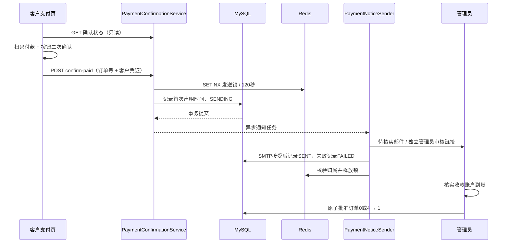

# 管理员邮件触发机制：实施与上线说明

日期：2026-10-28。依据已确认的[方案](管理员邮件触发机制方案.md)实施；适用于升级后创建的新订单。源码已修改，尚未部署到线上，也未对线上数据库执行迁移。

## 当前行为

1. 普通和 OpenAPI 下单只创建订单、返回支付信息，不发送管理员邮件。
2. 打开、刷新支付链接及状态轮询只读取确认信息，不发送邮件。
3. 客户实际扫码付款后，点击“我已完成付款”，在二次确认框中确认，才提交付款声明。
4. 数据库事务提交后，后台异步发送“客户声明已付款，待核实”邮件。支付页显示待管理员核实，停止付款倒计时，继续轮询审核结果。
5. 管理员核实真实到账后，通过原邮件审核链接批准或驳回。客户声明本身不会把订单标成成功，也不会触发商户回调。

个人收款码没有接入支付渠道到账回调，系统无法仅凭打开链接或客户按钮确认真实到账。客户确认是付款声明，到账仍需管理员核验。旧订单三个新增字段均保持 NULL，继续使用已有审核邮件，不补发、不迁移到新流程。



## 接口和凭证

普通 `AddOrderResp`、OpenAPI `OpenApiOrderResp` 新增 `paymentConfirmToken`；OpenAPI 的 `returnUrl` 已携带它，各查询参数分别编码。接入方应直接使用完整 `returnUrl`；自行拼接时必须保留该凭证并编码参数。请求签名算法未改变。

凭证为 32 字节安全随机数的 Base64URL 编码，数据库仅保存 SHA-256 哈希。它与管理员 Token 分离，不应公开发布完整支付链接。普通订单实体 JSON 不输出确认哈希、声明时间或通知状态；这三项通过专用鉴权响应提供。

### 查询：GET /order/payment-confirmation

查询参数 `orderId`，请求头 `X-Payment-Confirm-Token: <paymentConfirmToken>`。查询不发邮件，也不修改订单。

### 提交：POST /order/confirm-paid

`Content-Type: application/json`：

```json
{"orderId":"订单号","paymentConfirmToken":"下单响应中的客户凭证"}
```

两者均返回 `ResponseVO`：

```json
{
  "code": 200,
  "msg": "success",
  "data": {
    "orderState": 0,
    "amount": 9.90,
    "payType": "wechat",
    "payNum": "1234",
    "expireTime": null,
    "confirmedAt": null,
    "noticeStatus": "NOT_REQUESTED",
    "canConfirm": true,
    "retryable": false
  }
}
```

日期字段按 Spring/Jackson 日期配置序列化；示例使用 null 避免假定时区。`amount` 取数据库 `actualAmount`，为空时取 `money`。新支付链接从鉴权查询恢复可信金额、渠道和付款标识。业务错误通过外层 `code/msg` 判断：400 缺失参数、403 凭证无效、404 订单不存在、409 旧流程或订单不可再确认。

| 通知状态 | 含义 | 页面操作 |
| --- | --- | --- |
| NOT_REQUESTED | 尚未声明付款 | 展示确认按钮 |
| SENDING | 发送任务持有有效锁 | 等待，禁止重复提交 |
| SENT | SMTP 已接受邮件 | 等待管理员核实，不再重复发信 |
| FAILED | 发送失败，或 SENDING 的锁已过期 | 展示“重试通知管理员” |

`confirmedAt` 是首次声明时间，重试不会覆盖；通知失败不等于付款失败。已及时声明的订单在到期后仍允许重试通知；未声明且明确过期、被驳回或已终结的订单不能再提交。没有真实 `expireTime` 的新订单不会展示虚构的五分钟倒计时。

## 去重与失败边界

- Redis 键 `order:paid-notice:{orderId}`：发送尝试的 UUID，SET NX，有效期 120 秒。Lua 仅允许当前持有者释放锁，与旧页面清理的 `pay:*` 前缀隔离。
- 数据库持久保存 SENT；Redis 重启或发送锁消失不会让已发送订单再次通知。
- 事务回滚不会启动邮件任务；执行器拒绝、SMTP 异常或进程中断后可由客户主动重试，不自动补发旧订单。
- 管理员 Token 在发送前独立生成，重试复用仍有效的 Token；管理员链接不会放入客户响应。
- SENT 表示 SMTP 接受，不代表收件箱必定投递。SMTP 已接受但连接异常、或接受后数据库状态保存失败时，重试仍可能产生重复邮件；本实现不承诺跨 SMTP 与数据库的严格恰好一次投递。

## 数据升级与发布

新增列均可空：`payment_confirm_token_hash CHAR(64)`、`payment_confirmed_at DATETIME`、`admin_notice_status VARCHAR(16)`。普通实体更新禁止覆盖这些元数据，只有专用 SQL 修改声明及通知状态。

1. 备份现有 `t_order`，确认当前数据库和表结构；安排短维护窗口，避免旧版仍在创建订单时混合发布。
2. **已有数据库只执行一次**增量脚本：[20261028_payment_confirmation.sql](../../src/main/resources/sql/migrations/20261028_payment_confirmation.sql)。脚本只增加三列，不回填旧订单；重复执行会报列已存在，应先检查迁移记录和结构。
3. 不要在已有数据上重跑 [pay.sql](../../src/main/resources/sql/pay.sql)，该文件含 DROP TABLE，只用于首次初始化。
4. 字段升级成功后同时发布后端与模板，保留外置 `config`、`qr` 和私密 `.env`。新版本仍使用原网站、QQ SMTP、支付宝和微信收款码。
5. OpenAPI 商户使用包含 `paymentConfirmToken` 的完整支付页地址；只展示二维码而不提供确认入口的接入方式不会触发管理员邮件。
6. 先检查创建订单、打开链接及取消确认均无邮件，再以确实已付款的订单完成确认与管理员核实。测试 SMTP 请使用隔离邮箱或 Mock SMTP。

旧程序一般可继续使用新增列，但一旦已有新流程订单，回退旧代码可能重新在下单时发信，并失去新订单确认入口。回退前应停止新订单创建并保留新订单的审核处理渠道；不要删除新增列或确认记录。

## 验证记录

- JDK 8 / Maven 3.9.9：30 项 JUnit 测试通过，覆盖普通和 OpenAPI 创建不发信、事务提交/回滚、凭证鉴权、JSON 隐私、SMTP 结果、失败重试、管理员批准幂等、真实 Thymeleaf 模板渲染、特殊字符订单号 URL 编码。
- 独立临时 MySQL 8.0 / Redis 7：3 项集成测试通过，验证增量迁移保留旧记录、12 请求并发只获得一次发送资格、Lua 锁归属、SENT 持久去重及实体普通更新不覆盖确认元数据。生产 Compose 仍为 MySQL 5.7；未声称完成生产库联调。
- `node --test src/test/frontend/payment-confirmation.test.cjs`：7 项页面组件测试通过，覆盖打开/刷新/轮询/取消零提交、主动确认、失败重试、旧链接、无效凭证、刷新恢复和终态处理。
- 可执行 JAR 打包成功：`target/paypro-1.0-SNAPSHOT.jar`。1440px 桌面和 390px 手机真实浏览器预览通过，核对了主动确认、取消、刷新恢复、失败重试、旧/无效链接和横向布局，截图已目视检查；本地预览使用模拟接口。
- 使用实际打包的Spring Boot应用连接隔离MySQL/Redis及仅绑定loopback的Mock SMTP，验证真实HTTP下单和打开页面零发信、主动确认只接受1封模拟邮件、12次重复提交仍为1封、订单保持状态0；支付模板实际渲染成功。
- 测试没有向真实邮箱发送邮件，没有执行真实支付或线上商户回调。线上数据库迁移和部署需按上述顺序执行。

可重复测试命令：`mvn -s settings.xml test`、`mvn -s settings.xml package`。集成测试默认不运行，须明确指定 `-Dtest=PaymentConfirmationDatabaseIT`、`-Dpaypro.it.jdbcUrl=...` 与 `-Dpaypro.it.redisPort=...`，仅允许 loopback 的 `paypro_confirmation_it` 临时数据库。
