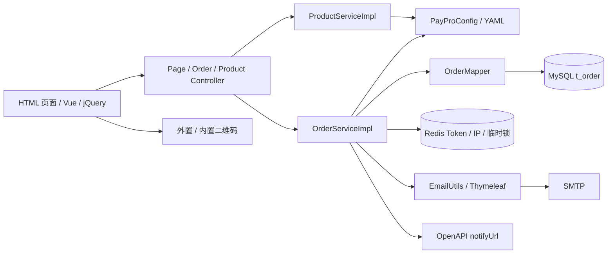
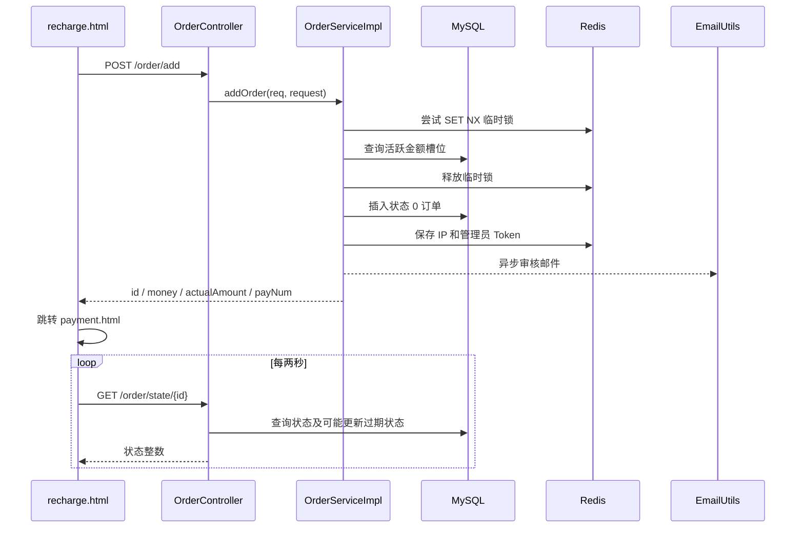
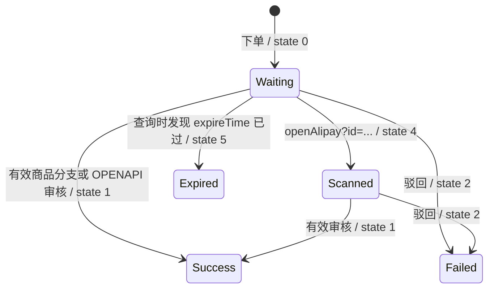

# 架构与业务流程

## 启动与基础设施

[PayApplication](../src/main/java/com/wendao/PayApplication.java) 开启 Spring Boot 自动配置、缓存、异步和调度支持，并扫描 `com.wendao.mapper`。开启调度只是启用框架，本仓库没有定时任务方法。

`PayProConfig` 绑定 `paypro` 前缀，既保存商品、支付方式和业务配置，也将 `/assets/qr/**` 映射到外置目录及 classpath 回退目录。`Config` 配置 CORS、MyBatis-Plus MySQL 分页、Snowflake Bean 和模板全局变量。Snowflake 已注入订单服务，但当前订单号不使用它。

模板全局变量为 `title / indexTitle / site / alipayUserId / alipayCustomQrUrl / mobile`。`name` 未加入，而 `openAlipay.html` 读取 `${name}`，存在变量缺失。

## 普通下单

1. `recharge.html` 用 `types=["CODE"]` 请求商品；支付方式来自页面硬编码，当前没有调用 `/getPayMethods`。
2. 用户选商品或输入金额并填邮箱，页面向 `/order/add` 发送 JSON。前端只校验金额大于零、支付方式和邮箱非空；后端 `OrderReq` 仅对 `money` 加 `@NotNull`。
3. 控制器把 User-Agent 写入 `device`，服务复制请求属性，判定是否启用减额。
4. 服务尝试分配实际金额，随机选择二维码编号；减额模式不生成备注，其他模式生成四位 `payNum`。
5. `thisService.addOrder(Order)` 经 Spring 代理调用，生成 UUID、创建时间和状态 0，插入数据库。其默认匹配模式为 REMARK，默认实际金额为原始金额。
6. Redis 写入 IP 记录和管理员 Token；服务拼接审核链接，异步发送 `payment-review` 邮件。
7. 返回 `AddOrderResp`，页面构建 `payment.html?...` 地址。支付页显示二维码并每两秒请求 `/order/state/{id}`。

普通下单没有从商品配置重新计算价格，没有设置 `orderSource`、`expireTime`、`downloadUrl`。数据库给 `order_source` 配置了 PRODUCT 默认值，但插入对象仍可能是 null；实际入库是否采用数据库默认值取决于生成的 INSERT，需运行验证。

## 减额匹配

启用条件：`decrement.enabled=true`、非自定义金额、支付方式配置 `use-local-qr-code=true`，且支付方式不是 `wechat_zs`。

对基准价 `B`，步长 `s`，`maxCount=N`，候选实际金额为 `B - i × s`，`i=0..N`。因此 `maxCount=2` 实际有三个候选，不是两个。非正数或找不到任意编号二维码的候选被跳过。

候选活跃条件是 `actual_amount` 相同、`match_mode='DECREMENT'`、状态在 `(0,4)`。源码查询没有按支付类型、基础金额、二维码编号和过期时间隔离。选择第一个可用槽位；全部不可用时退回 REMARK，实际金额为 `B+s`，并要求填写备注。

以 5.00、步长 0.01、最大递减次数 2 为例：

| 情况 | 实际金额 | 模式 | 二维码路径，编号以 1 为例 |
| --- | --- | --- | --- |
| 第一个候选 | 5.00 | DECREMENT | `wechat/5.00/1.png` |
| 第二个候选 | 4.99 | DECREMENT | `wechat/5.00/4.99/1.png` |
| 第三个候选 | 4.98 | DECREMENT | `wechat/5.00/4.98/1.png` |
| 无可用候选 | 5.01 | REMARK | 预期 `wechat/5.00/5.01/1.png` |

锁键为 `pay:decrement_lock:{payType}:{baseAmount}`，TTL 五秒，最多尝试三次，失败间隔 100ms。**未获锁时仍分配；释放锁在实际 INSERT 前；没有唯一约束**，因此这段代码不能保证并发金额唯一。

`checkAnyQrFileExists` 只查 classpath，未查外置 `qr-dir`；另一个 `checkQrFileExists` 才支持外置目录。这会使只放在外部的减额二维码无法参与槽位检测。

## OpenAPI 下单

入口依次校验时间戳、签名、金额范围与订单号重复。外部 `orderNo` 直接作为 `t_order.id`，设置来源 OPENAPI；减额路径与普通订单类似，然后生成二维码 URL、支付页 URL、插库、存 Token、发审核邮件并返回。

`description` 参与验签但未写入订单；`expireSeconds` 参与验签但未转为 `expireTime`；`custom` 影响业务却没有参与签名，也未写入实体。普通备注分支对二维码存在判断使用了反向条件，详见问题清单。

## 审核与回调

`/order/pass` 要求 Redis 中订单 Token 匹配，同时 `myToken` 等于配置口令，再调用 `pass(id)`：

- PRODUCT 且有商品 ID：读取配置商品，只有 CODE 类型进入发成功邮件和设置状态 1 的分支。服务没有把商品 `downloadUrl` 放入订单；邮件模板中的下载地址又被注释。
- OPENAPI：`callbackFaka` 对 `orderNo / amount / payNum` 签名，HTTP POST 到 `notifyUrl`，之后设置状态 1。使用原始 `money` 而非 `actualAmount`，不包含支付类型、状态或时间戳；不检查对方响应正文，没有重试和回调状态记录。
- 其他来源、PRODUCT 无商品、非 CODE 类型：方法仍返回 1，但没有将订单标为成功。来源为 null 时调用 `.equals(...)` 会抛异常。

`/order/back` 直接设状态 2，用户邮箱有效时发送失败邮件；`/order/del` 直接删除数据库记录。批准、驳回和删除均没有原状态条件约束。重复批准 OPENAPI 订单可能重复发送业务回调。

## 订单状态

实际枚举：0 待支付、1 成功、2 失败、4 已扫码、5 过期。旧注释与 OPEN_API.md 中的状态 3 不是当前枚举成员。

此图表示主要业务意图；当前实现约束更弱：`changeOrderState` 不校验原状态；打开 `openAlipay?id=...` 可覆盖终态为 4，并删除所有 `pay:*` 缓存；状态查询对任何已有过期时间的过期订单都返回 5，但只有原状态 0 会被写入 5。当前创建路径未设置过期时间，也没有周期清理任务。
