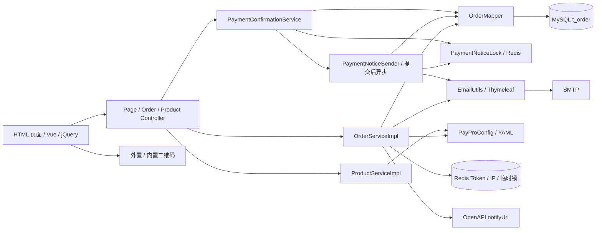
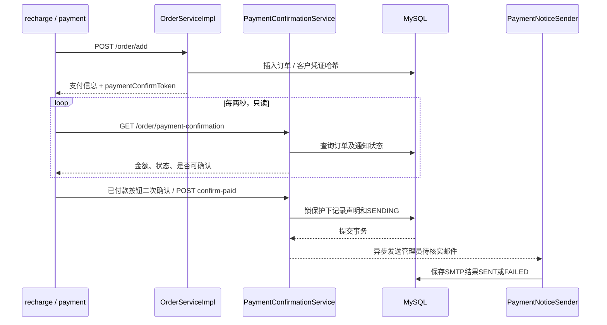
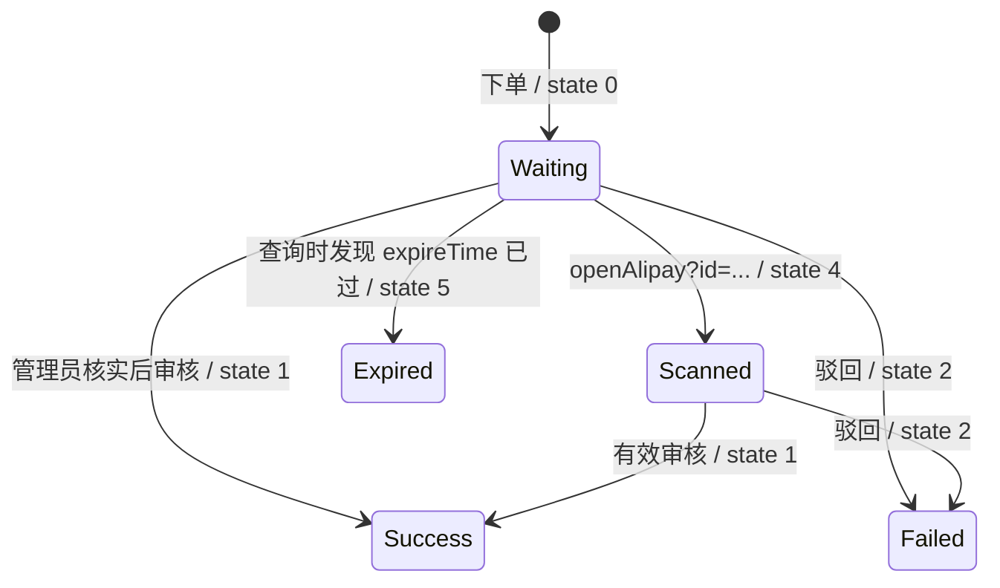

# 架构与业务流程

## 启动与基础设施

[PayApplication](../src/main/java/com/wendao/PayApplication.java) 开启 Spring Boot 自动配置、缓存、异步和调度支持，并扫描 `com.wendao.mapper`。开启调度只是启用框架，本仓库没有定时任务方法。

`PayProConfig` 绑定 `paypro` 前缀，既保存商品、支付方式和业务配置，也将 `/assets/qr/**` 映射到外置目录及 classpath 回退目录。`Config` 配置 CORS、MyBatis-Plus MySQL 分页、Snowflake Bean 和模板全局变量。Snowflake 已注入订单服务，但当前订单号不使用它。

模板全局变量为 `title / indexTitle / name / supportMail / site / alipayUserId / alipayCustomQrUrl / mobile`。当前页面显示网站品牌、收款人和客服邮箱；EmailUtils 也将品牌、收款人与客服邮箱加入邮件上下文，见 [网站与邮件配置](13-site-and-mail-configuration.md)。

## 普通下单

1. `recharge.html` 用 `types=["CODE"]` 请求商品；支付方式来自页面硬编码，当前没有调用 `/getPayMethods`。
2. 用户选商品或输入金额并填邮箱，页面向 `/order/add` 发送 JSON。前端只校验金额大于零、支付方式和邮箱非空；后端 `OrderReq` 仅对 `money` 加 `@NotNull`。
3. 控制器把 User-Agent 写入 `device`，服务复制请求属性，判定是否启用减额。
4. 服务尝试分配实际金额，随机选择二维码编号；减额模式不生成备注，其他模式生成四位 `payNum`。
5. `thisService.addOrder(Order)` 经 Spring 代理调用，生成 UUID、创建时间和状态 0，插入数据库。其默认匹配模式为 REMARK，默认实际金额为原始金额。
6. 为新订单生成独立客户确认凭证，只落库 SHA-256 哈希；Redis 写 IP 记录，下单不创建管理员 Token、不发邮件。
7. 返回含 `paymentConfirmToken` 的 `AddOrderResp`，页面构建完整支付链接。支付页用鉴权 GET 每两秒只读轮询，客户完成扫码付款并二次确认后才 POST 付款声明。事务提交后异步通知管理员。

普通下单明确设置 PRODUCT 或 OTHER 来源；自定义金额清除此前选中的商品 ID，并拒绝空值及非正金额。尚未从商品配置重新计算价格，也未设置 `expireTime`、`downloadUrl`。新流程详见 [管理员邮件触发机制：实施与上线说明](01-管理员邮件触发机制/实施与上线说明.md)。

## 减额匹配

启用条件：`decrement.enabled=true`、非自定义金额、支付方式配置 `use-local-qr-code=true`，且支付方式不是 `alipay`、`wechat` 或 `wechat_zs`。当前两份配置关闭减额，支付宝、微信均使用用户提供的通用码，按原始订单金额付款并填写标识，详见 [支付宝收款码更新](11-alipay-qr-update.md) 和 [微信收款码更新](12-wechat-qr-update.md)。以下为保留的减额算法说明，当前两种支付方式不调用它。

对基准价 `B`，步长 `s`，`maxCount=N`，候选实际金额为 `B - i × s`，`i=0..N`。因此 `maxCount=2` 实际有三个候选，不是两个。非正数或找不到任意编号二维码的候选被跳过。

候选活跃条件是 `actual_amount` 相同、`match_mode='DECREMENT'`、状态在 `(0,4)`。源码查询没有按支付类型、基础金额、二维码编号和过期时间隔离。选择第一个可用槽位；全部不可用时退回 REMARK，实际金额为 `B+s`，并要求填写备注。

以 5.00、步长 0.01、最大递减次数 2 为例：

| 情况 | 实际金额 | 模式 | 二维码路径，编号以 1 为例 |
| --- | --- | --- | --- |
| 第一个候选 | 5.00 | DECREMENT | `wechat/5.00/1.png` |
| 第二个候选 | 4.99 | DECREMENT | `wechat/5.00/4.99/1.png` |
| 第三个候选 | 4.98 | DECREMENT | `wechat/5.00/4.98/1.png` |
| 无可用候选 | 5.01 | REMARK | 预期 `wechat/5.00/5.01/1.png` |

锁键为 `pay:decrement_lock:{payType}:{baseAmount}`，TTL 五秒，最多尝试三次，失败间隔 100ms。**未获锁时仍分配；释放锁在实际 INSERT 前；没有唯一约束**，因此这段代码不能保证并发金额唯一。

`checkAnyQrFileExists` 只查 classpath，未查外置 `qr-dir`；另一个 `checkQrFileExists` 才支持外置目录。这会使只放在外部的减额二维码无法参与槽位检测。

## OpenAPI 下单

入口依次校验时间戳、签名、金额范围与订单号重复。外部 `orderNo` 直接作为 `t_order.id`，设置来源 OPENAPI；减额路径与普通订单类似，然后生成客户确认凭证、编码后的支付页 URL 并插库返回；创建阶段不生成管理员 Token、不发邮件。

`description` 参与验签但未写入订单；`expireSeconds` 参与验签但未转为 `expireTime`；`custom` 影响业务却没有参与签名，也未写入实体。普通备注分支对二维码存在判断使用了反向条件，详见问题清单。

## 审核与回调

`/order/pass` 要求 Redis 中订单 Token 匹配，同时 `myToken` 等于配置口令，再调用 `pass(id)`：

- 原子更新状态 0/4 → 1；重复批准已成功订单直接返回，避免重复发送业务回调。
- OPENAPI：在数据库事务内调用现有 `callbackFaka`，成功提交后状态为 1。回调仍使用原始 `money`，没有接收方应答检查或自动重试。
- 其他来源（包括无商品、自定义金额和旧数据空来源）：正常设置成功状态；邮箱有效时在事务提交后发成功通知。不扩展商品交付功能。

`/order/back` 仍直接设状态 2 并可发失败通知；`/order/del` 仍直接删除。批准增加了状态约束，驳回、编辑及旧页面入口仍保留原有行为，其风险见问题清单。

## 订单状态

实际枚举：0 待支付、1 成功、2 失败、4 已扫码、5 过期。旧注释与 OPEN_API.md 中的状态 3 不是当前枚举成员。

客户声明付款独立保存在确认字段，订单编号状态不增加成员；确认后仍为 0/4，直到管理员批准或驳回。状态查询仅将未声明、待处理且明确过期的订单判为 5，已成功或待审核记录不会因查询而超时。旧 `changeOrderState` 和 `openAlipay?id=...` 仍缺少状态约束，后者还会清理 `pay:*`；新通知锁使用独立前缀。当前创建路径未设置过期时间，也没有周期清理任务。
