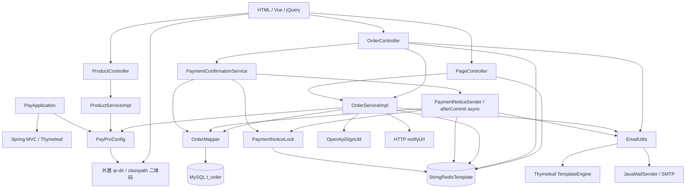

# PayPro CodeGraph

阅读日期 2026-10-28（Asia/Shanghai）。工具版本 0.9.9；索引绑定当前项目根目录。

## 原生索引结果

- 已索引 **55 文件**，包含 **45 Java 文件**。
- **1309 节点、2237 关系**；文件解析错误数 **0**。
- 原始项目 **168 文件**；HTML、CSS、SQL、Shell、Markdown、图片和二进制未全部进入原生符号索引，见全量文件清单。
- 本地 SQLite：`.codegraph/codegraph.db`；该目录内自带 .gitignore 排除数据库，应通过命令重新生成。
- 保留关系 metadata 的 confidence / resolvedBy；静态解析中的同名、重载、fuzzy 匹配不能等同于运行时真实调用。
- 原生 unresolved_refs 为 0；待解析引用或空表都不能证明第三方调用、框架注入和动态关系已完整解析。
- 增量同步也会索引 docs/tools 中的 Python 文档生成脚本；全量 JSON 和 calls 图保留这些辅助脚本节点，Java 依赖图只包含业务 Java 文件。

## 经源码核对的架构图



架构图中的 Spring 注入、资源和外部服务关系是阅读源码后的补充，并非全部来自原生边。

## 图谱文件

| 文件 | 用途 |
| --- | --- |
| [codegraph.json](codegraph.json) | 全部原生节点 / 边、文件元数据与原始文件哈希；省略 docstring、decorators 等潜在敏感配置值 |
| [codegraph.mmd](codegraph.mmd) | 上方运行架构的 Mermaid 原文件 |
| [codegraph-dependencies.mmd](codegraph-dependencies.mmd) | 所有 Java 文件的内部 import 依赖，通配导入保守展开，不代表每个类型都实际调用 |
| [codegraph-calls.mmd](codegraph-calls.mmd) | 原生 calls 关系的 Mermaid 导出，包括可能的低置信度边 |
| [源码符号目录](08-source-catalog.md) | 所有 Java 显式符号与源码位置 |

## 节点类别

| kind | 数量 |
| --- | ---: |
| class | 53 |
| constant | 146 |
| enum | 2 |
| enum_member | 9 |
| field | 261 |
| file | 52 |
| function | 40 |
| import | 448 |
| interface | 3 |
| method | 220 |
| namespace | 45 |
| route | 18 |
| variable | 12 |

## 关系类别

| kind | 数量 |
| --- | ---: |
| calls | 451 |
| contains | 1104 |
| implements | 2 |
| imports | 440 |
| instantiates | 60 |
| references | 180 |

## 索引语言

| 语言 | 文件数 |
| --- | ---: |
| java | 45 |
| javascript | 4 |
| python | 1 |
| xml | 2 |
| yaml | 3 |

## 路由节点

原生索引的 18 个节点，favicon 的第二个 URL 别名需以接口文档为准。

| 路由 | 源码 | 行 |
| --- | --- | ---: |
| `POST /order/confirm-paid` | [OrderController.java](../src/main/java/com/wendao/controller/OrderController.java) | 53 |
| `GET /order/payment-confirmation` | [OrderController.java](../src/main/java/com/wendao/controller/OrderController.java) | 59 |
| `ANY /order/list` | [OrderController.java](../src/main/java/com/wendao/controller/OrderController.java) | 75 |
| `GET /order/state/{id}` | [OrderController.java](../src/main/java/com/wendao/controller/OrderController.java) | 83 |
| `GET /order/{id}` | [OrderController.java](../src/main/java/com/wendao/controller/OrderController.java) | 109 |
| `POST /order/add` | [OrderController.java](../src/main/java/com/wendao/controller/OrderController.java) | 130 |
| `POST /order/edit` | [OrderController.java](../src/main/java/com/wendao/controller/OrderController.java) | 139 |
| `GET /order/pass` | [OrderController.java](../src/main/java/com/wendao/controller/OrderController.java) | 169 |
| `GET /order/back` | [OrderController.java](../src/main/java/com/wendao/controller/OrderController.java) | 197 |
| `GET /order/del` | [OrderController.java](../src/main/java/com/wendao/controller/OrderController.java) | 228 |
| `POST /order/statistic` | [OrderController.java](../src/main/java/com/wendao/controller/OrderController.java) | 257 |
| `POST /api/openapi/add` | [OrderController.java](../src/main/java/com/wendao/controller/OrderController.java) | 274 |
| `POST /getPayMethods` | [OrderController.java](../src/main/java/com/wendao/controller/OrderController.java) | 296 |
| `ANY /` | [PageController.java](../src/main/java/com/wendao/controller/PageController.java) | 34 |
| `ANY /{page}` | [PageController.java](../src/main/java/com/wendao/controller/PageController.java) | 39 |
| `GET /favicon.ico` | [PageController.java](../src/main/java/com/wendao/controller/PageController.java) | 63 |
| `GET /product/get` | [ProductController.java](../src/main/java/com/wendao/controller/ProductController.java) | 28 |
| `POST /product/getListByType` | [ProductController.java](../src/main/java/com/wendao/controller/ProductController.java) | 35 |

## 查询与刷新

在项目根目录执行：

```powershell
codegraph status .
codegraph query OrderServiceImpl --path . --json
codegraph callers pass --path .
codegraph callees createOpenApiOrder --path .
codegraph impact OrderMapper --path .
codegraph index . --force --quiet
& 'D:\Work\Python\conda\python.exe' -X utf8 docs/tools/generate_project_index.py
& 'D:\Work\Python\conda\python.exe' -X utf8 docs/tools/generate_project_index.py --check
```

没有索引时先执行 `codegraph init .`。只更新索引不会自动更新人工编写的业务说明。本次 MCP 传输不可用后使用 CLI 和 SQLite 只读导出，未使用其他工作区的索引数据。

Mermaid 代码可在支持 Mermaid 的 Markdown 编辑器中查看，或把 .mmd 导入渲染工具。原生索引不会自动生成浏览器交互界面。本次未安装图形渲染器，校验覆盖结构与文件一致性，未进行图片渲染验证。
